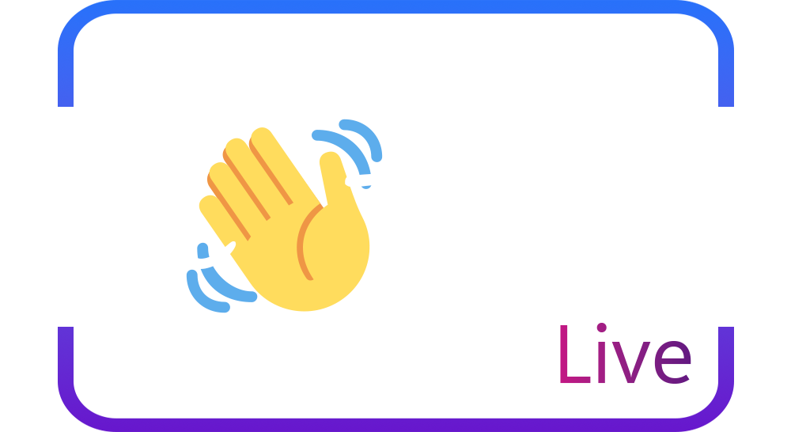

# Hi time live

<p align="center">
  
</p>
<p align="center">
    A free peer-2-peer WebRTC based video conferencing.
</p>

## What is it?

This video conferencing software combines three technologies to create an all-in-one web application:

1. WebRTC with html/JavaScript in the client-side browser to handle the user interface.
2. Continuous Server Sent Event communication channel for realtime updates.
3. Signaling server to facilitate the connection information, written in go.

<p align="center">
  
</p>

Advantages of peer-2-peer connection-oriented video conferencing:

- Privacy for the users since none of the video or connection information is stored on a server.
- Latency on videos will be ideal because video routing and processing does not use an intermediary server.
- Reduced management expense for the server, since the server merely forwards messages and does not handle live video or store information in memory.

Disadvantages:

- Higher bandwidth and CPU usage, since the client must process more video streams from each peer.
- Fewer centralized features, such as effects or controls.
- Requires complicated and somewhat error-prone communication between clients, each other, and the backend. 

## How to use it

A deployed version is available at https://gportal.link/hitime.

you can also deploy your own server using the docker image provided at dockerhub with `gtstef/hitime` or building locally.

### Serving under a URL prefix

To run behind a reverse proxy at a sub path (e.g. `https://example.com/hitime/`),
set `BASE_PATH=/hitime` (or pass `--base-path /hitime`). The app then serves
everything under `/hitime/`, redirects `/hitime` to `/hitime/`, and returns 404
for paths outside the prefix. Proxy the location through unchanged, without
stripping the prefix, and keep buffering off for the `/events` SSE stream:

```nginx
location /hitime/ {
    proxy_pass http://hitime:9012;
    proxy_http_version 1.1;
    proxy_buffering off;
    proxy_read_timeout 1h;
}
```

Note: The frontend features require an HTTPS connection, so any build should be done behind one. I have included the `generate_cert.go` standard library for quick mock certificate creation for local testing.

### TURN / ICE configuration

STUN alone cannot traverse symmetric NAT or a restrictive firewall. Peers behind
those complete signaling and then never connect, which is the failure a relay
fixes. Point the server at a TURN relay so those users get a relayed path:

| Flag | Env | Meaning |
| --- | --- | --- |
| `--turn-url` | `TURN_URL` | TURN URL(s), comma separated, e.g. `turn:turn.example.com:3478` |
| `--turn-username` | `TURN_USERNAME` | TURN username |
| `--turn-credential` | `TURN_CREDENTIAL` | TURN credential |
| `--ice-servers` | `ICE_SERVERS` | Full `RTCIceServer[]` JSON override; wins over the flags above |

The list is rendered into the room page and the browser builds its connections
from it. The credentials are therefore visible to anyone who can load the page
(inherent to WebRTC); prefer short-lived TURN credentials where the relay
supports them.

For diagnosing a peer that never connects, the room page accepts:

- `?relay=1` — force relay-only ICE, ignoring host and STUN candidates. This
  reproduces "this user's NAT admits no direct path".
- `?noturn=1` — drop TURN servers from the list.
- `?connecttimeout=<ms>` — shorten the connect watchdog (default 20000).

`make test-e2e-turn` starts a local coturn and runs the relay-only spec through
it, which is the end-to-end proof that the configured relay is actually used.

## Testing

- `make test` runs the Go unit/integration tests (room lifecycle, signaling
  routing, isolation, disconnects, ICE configuration) under the race detector.
- `make test-e2e` runs the Playwright suite in `tests/e2e`, which drives one
  Chromium process per peer with deterministic fake camera/microphone input and
  asserts real media over `getStats` and pixel/tone identity.
- `make test-e2e-base-path` runs the same suite against the app mounted under
  `/hitime` (`HITIME_BASE_PATH`), which is how it is deployed behind gportal.
- `make test-e2e-turn` additionally starts a coturn container and runs the
  relay-only spec, proving a relay candidate is really used. It needs host
  networking (CI, or Docker Desktop with host networking enabled).
- The suite covers the "never connects" failure directly: `08-ice-failure.spec.ts`
  uses `?relay=1&noturn=1` to make "no usable network path" deterministic and
  asserts the failure is surfaced rather than silently hanging.

The signaling contract is documented in [docs/signaling-protocol.md](docs/signaling-protocol.md),
and the remaining hardening work in [docs/hardening-plan.md](docs/hardening-plan.md).

## Browser Support

WebRTC has broad browser support

 |  |  |  |  
--- | --- | --- | --- | --- |
 ✅ |  ✅ | ✅ | ✅ | ✅ |

